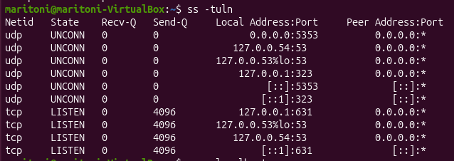
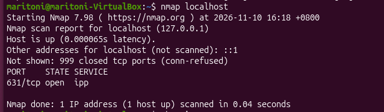
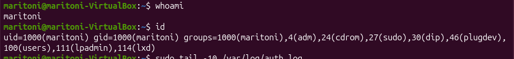
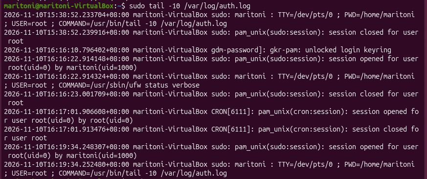

Ubuntu Hardening Lab

Objective:
Learn Linux security fundamentals by hardening and Ubuntu virtual machine.

Security Actions Performed:

Firewall Configuration
Checked firewall status
Enable UFW firewall

Open Ports ANalysis
Command: ss -tuln

Findings: 
- Port 53 (DNS)
- Port 5353 (mDNS)
- Port 631 (CUPS)

Risk Assessment: Low risk. Services are mostly bound to localhost. 

Lessons Learned:
1. Ubuntu uses UFW for firewall management.
2. Firewalls help control incoming and outgoing traffic.
3. Enabling a firewall is one of the first steps in securing a Linux system.

NMAP SCAN

Command Used: nmap localhost
Results: PORT STATE SERVICE 61/tcp open ipp

Analysis: 
- Only one TCP port was found open.
- Port631 is used by the CUPS printing service.
- No SSH, web server, or database service were detected.
- The system has a relatively small attack surface.

Security Assessment:

The Ubuntu VM appears to be in a secure default state with minimal exposed services.

User Account Audit 

Command Used: 
whoami
id
cat /etc/passwd

Findings:
- Current user: maritoni
- User belongs to the sudo group, allowing administrative actions.
- Multiple Linux system accounts were present.
- Most system accounts use /usr/sbin/nologin and cannot login directly.

Security Assessment:
The system follows the priciple of least privilege for service accounts. Administrative access is restricted to authorized users in the sudo group.

Log Analysis

Commands Used: sudo tail -20 /var/log/auth.log

Findings:
- Observed authentication and sudo activity.
- User "maritoni" executed administrative commands.
- No failed login attempts observed.
- No suspicious authentication activity detected.

Security Assessment:
System logs showed normal user and administrative activity. No signs of unauthorized access were identified during the review.

Python Port Scanner
Objective:
Create a Python script to identify open ports on the local machine.

Technologies used:
- Python 3
- Socket Library

Code Functionality
- Scans port 1-1024
- Detects open TCP ports
- Reports discovered services

Results
The scanner detected: Port 631 
The findings matched the results from Nmap.

Lessons Learned: 
- Learned how sockets work.
- Learned basic network enumeration.
- Compared custom scripts against proffessional security tools.

Screenshots:
Firewall Configuration:

Open Ports Analysis

Nmap Scan 

User Account Audit

Log Analysis

Python Port Scanner

